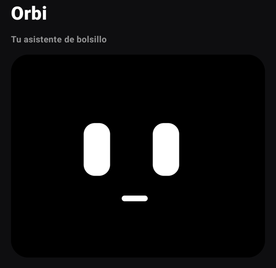
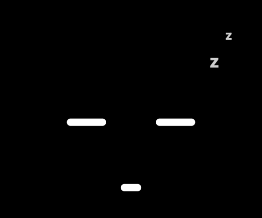
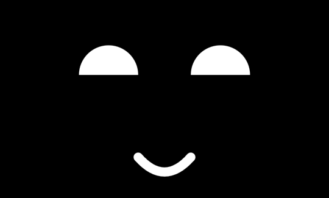

# 🤖 Orbi

Un asistente robot para Android que vive en tu pantalla. Flota sobre cualquier app dentro de un marco negro, **te sigue con la mirada** usando la cámara frontal y **decide sus propias expresiones** según lo que pasa a su alrededor: lo tocas, lo sacudes, lo lanzas, le guiñas, le tapas la cámara...

<p align="center">
  
  
</p>
<p align="center">
  
  
</p>

> **Estado:** v0.2. Cara, burbuja flotante, modo noche, cerebro de emociones, cámara, sensores, sonidos y bienvenida guiada.

## Qué puede hacer

| Haces esto | Orbi hace esto |
|---|---|
| Lo miras | Te sigue con los ojos |
| Sonríes | Sonríe contigo |
| Inclinas la cabeza | Inclina la suya igual |
| Le guiñas un ojo | Te devuelve el guiño |
| Abres la boca | Se sorprende contigo |
| Asientes / niegas con la cabeza | Asiente feliz / niega un poco triste |
| Pones el celular boca abajo | Bosteza y se echa una siesta; al levantarlo, despierta |
| Apagas la luz del cuarto | Le da sueño (ojos a medio cerrar) |
| Tapas la cámara | Se asusta y te busca; al destaparla: "¡te encontré!" |
| Lo tocas | Se alegra (5 toques seguidos: se enoja) |
| Lo acaricias (mantener y frotar) | Cierra los ojitos y ronronea |
| Sacudes el celular | Ojos en espiral, se marea |
| Lanzas la burbuja | Vuela, rebota en los bordes y queda mareado |
| Inclinas el celular | Sus ojos "caen" hacia abajo |
| Te llega una notificación | Se sorprende y mira hacia arriba |
| Lo ignoras 2 minutos | Bosteza y se duerme |
| Lo pones a cargar / batería baja | Se alegra / se pone triste |

Además: **burbuja flotante** que se arrastra, se pega a los bordes y se cierra soltándola sobre una X, y **modo noche** a pantalla completa con brillo mínimo y protección contra quemado de pantalla OLED.

## Cómo funciona

```
 Cámara frontal ──► FaceTracker (ML Kit, en el celular) ──┐
 Acelerómetro   ──► MotionSense (sacudidas, inclinación) ──┤
 Notificaciones ──► NotificationWatcher (sin leer texto) ──┼──► MoodEngine ──► OrbiState ──► LiveOrbiFace
 Toques         ──► Burbuja / App / Modo noche ────────────┤     (cerebro)       (estado)      (Compose Canvas)
 Batería        ──► OrbiApp ───────────────────────────────┘          │
                                                                        └──► SoundFx (sonidos sintetizados)
```

- **`MoodEngine`**: decide la expresión en dos capas: *reacciones* cortas a eventos y un *ánimo de fondo* (dormido, contento, triste...).
- **`OrbiFace`**: dibuja la cara con Canvas. Cada expresión son unos pocos números que se animan con resortes, así que los ojos se *transforman* en vez de saltar.
- **`SoundFx`**: los sonidos se generan con código (barridos de frecuencia, vibrato), sin archivos de audio.
- **`BubbleService`**: servicio en primer plano que dibuja la burbuja sobre otras apps, con física simple para lanzarla.

## Privacidad

- La cámara se procesa **en el celular** con ML Kit. No se guardan ni se envían imágenes; solo salen tres datos: si hay cara, dónde está y su expresión.
- Las notificaciones **no se leen**: Orbi solo sabe que llegó algo.
- El seguimiento con la cámara y los sonidos se pueden apagar desde la app.

## Compilar

Requisitos: Android Studio (JDK incluido) y un celular con Android 8.0 o superior.

```bash
./gradlew assembleDebug
adb install -r app/build/outputs/apk/debug/app-debug.apk
```

Permisos que pide: **Mostrar sobre otras apps** (burbuja), **Cámara** (mirada), **Notificaciones** (servicio en primer plano) y, opcionalmente, **Acceso a notificaciones** (reaccionar a mensajes).

## Roadmap

- [x] v0.1: cara animada, burbuja, modo noche, cerebro de emociones, cámara, sensores y sonidos
- [x] v0.2: bienvenida guiada, preferencias guardadas, posición de la burbuja, vuelve tras reiniciar, boca abajo = siesta, luz del cuarto, boca abierta, sí/no con la cabeza, transiciones con personalidad, modo ahorro de cámara
- [ ] Voz y cerebro con Claude
- [ ] Recordatorios y tareas
- [ ] Leer y responder mensajes (con confirmación)
- [ ] Vigilancia nocturna

## Stack

Kotlin · Jetpack Compose · CameraX · ML Kit Face Detection · Android Sensors · AudioTrack · Coroutines / StateFlow
